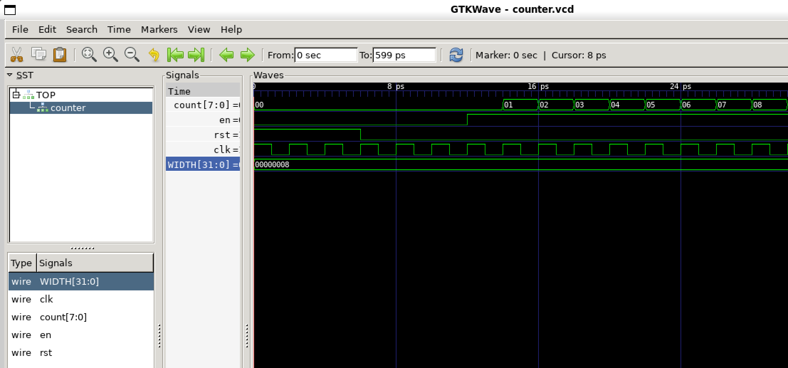
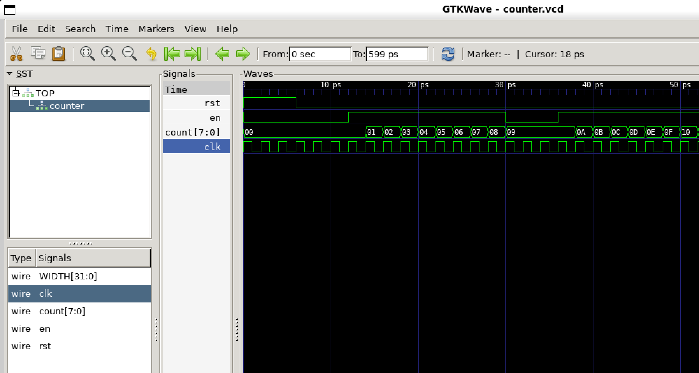

# Task 1: Binary counter

## What I implemented
An 8-bit counter with synchronous reset and enable.

## Testing
I compiled the design with Verilator, typed & ran the testbench,
and viewed counter.vcd in GTKWave.

## Waveform observations
- When reset is high, the next rising clock edge clears the count.
- When enable is low, the count holds its value. 
- When enable is high and reset is low, each rising edge increments it.

## Why counting starts later 
The testbench initially sets enable to zero.
The expression `i > 4` first becomes true at i = 5.
Because enable is assigned after the clock loop, counting begins
on the rising edge during iteration i = 6, hence why it appears as such on GTKWave.



## What does the time scale mean?
According to my code snippet: tfp->dump(2*i + clk); 
There are two timestamps per clock cycle, making the displayed clock period 2 ps.

## CHALLENGE YOURSELF
Task 1: 
To make the counter pause for 3 cycles, I concluded it would be best to stop variable en (enable) by turning it on and off again for 3 cycles. I declared a variable pause_cycles to count the number of cycles paused and when it becomes greater than 3, renabling the loop, and so at the next rising edge (so on the 4th cycle), it follows the instruction. 



Task 2: 
Implementing an asynchronous reset involves removing the dependency of reset from clock. This means at the alwaysff loop, we add an or condition "or posedge rst", meaning the block also runs when rst has a rising edge, not iff clock has one. 

## Commands used
```bash
verilator -Wall --cc --trace counter.sv --exe counter_tb.cpp
make -j -C obj_dir/ -f Vcounter.mk Vcounter
obj_dir/Vcounter
gtkwave counter.vcd